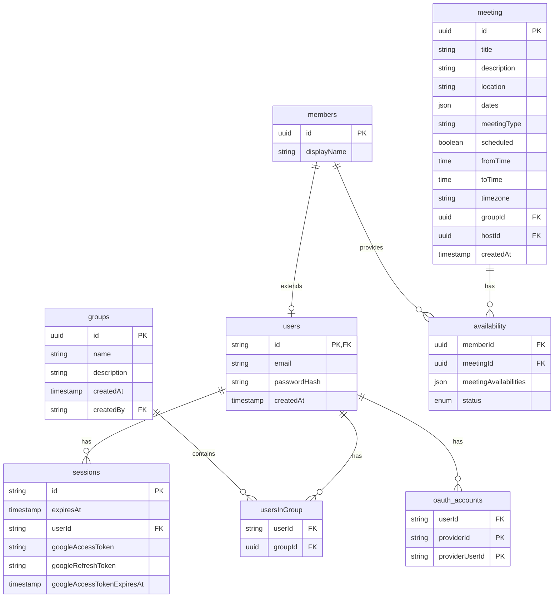

# About

Simple, clean, and efficient meeting scheduling app.


## Tech Stack

- [SST](https://sst.dev)
- [Drizzle](https://orm.drizzle.team/)
- [Lucia](https://lucia-auth.com)
- [Next](https://nextjs.org/)

# Contributing

## Project Structure

```md
├── README.md
├── apps
│   └── mobile          # Expo / React Native prototype (see below)
├── drizzle.config.ts
├── next.config.mjs
├── node_modules
├── package.json
├── src
│   ├── app
│   │   └── [ all front-end routes ]
│   ├── components
│   │   └── [ front-end components ]
│   ├── db
│   │   ├── index.ts
│   │   ├── migrations
│   │   └── schema.ts
│   ├── lib
│   └── server
│       ├── actions ( mutate or insert data )
│       │       └── [ entity ]
│       │           └── [ verb ]
│       │               └── action.ts
│       └── data ( query data )
│           └── [ entity ]
│               └── queries.ts
└── tsconfig.json
```

## Local Development

### Prerequisites

- [Git](https://git-scm.com/downloads)
- [Node.js](https://nodejs.org/en/)
- [pnpm](https://pnpm.io)
  - Just run `npm i -g pnpm` to install.
- [Docker Desktop](https://www.docker.com/products/docker-desktop/) 

### Local Setup

1. Clone this repository locally
2. Navigate to the root directory and install the dependencies.
   1. `cd ZotMeet`
   2. `pnpm install`
3. Copy the example environment file:
   ```bash
   cp .env.example .env
   ```
4. Make sure Docker Desktop is running, then set up the database:
   ```bash
   pnpm db:setup
   ```
5. Start the development server
   1. `pnpm dev` (run `pnpm dev --host` if you want to access the server from other devices on your network)
6. The app should be viewable at `localhost:3000` by default.

### Mobile app (Expo)

`apps/mobile` is the React Native client (Expo Router). It mirrors the web app's structure, shares its colour tokens (`packages/tokens`) and domain helpers (`packages/shared`), and talks to the same database through the web app's `/api` routes. It does not replace the PWA.

Start the Expo bundler in a second terminal while `pnpm dev` is running for the web app and `/api` routes:

```bash
pnpm mobile
```

That starts the Expo bundler. From the terminal, press `i` (iOS Simulator), `a` (Android emulator), or `w` (web preview), or scan the QR code with [Expo Go](https://expo.dev/go) on a physical device (same Wi-Fi as your machine). More detail lives in `apps/mobile/README.md`.

## Try the mobile app

<!--
  The QR code is generated by Expo from the query below and opens the latest
  EAS Update on the `main` channel, published by
  .github/workflows/mobile-main.yml on every push to main that touches the
  mobile bundle. `runtimeVersion` follows app.config.ts's `sdkVersion` policy
  (`exposdk:<Expo SDK major>.0.0`), so bump it here whenever apps/mobile
  upgrades the `expo` package, then run the workflow by hand once.
-->
<a href="https://expo.dev/accounts/ethanchaos-team/projects/zotmeet/updates">
  
</a>

Scan with [Expo Go](https://expo.dev/go) (iOS: the Camera app; Android: Expo Go's scanner) to run the `main` branch on your phone. It talks to production (`zotmeet.com`). You must be signed in to Expo Go with an account in the ZotMeet organization; see [`apps/mobile/README.md`](apps/mobile/README.md#6-pr-previews-on-a-real-device-expo-go) for access and for the per-PR previews.

### Database Commands

| Command | Description |
|---------|-------------|
| `pnpm db:setup` | Start database and run migrations (first time setup) |
| `pnpm db:start` | Start the PostgreSQL container |
| `pnpm db:stop` | Stop the PostgreSQL container (data persists) |
| `pnpm db:reset` | Reset database - removes all data and re-runs migrations |
| `pnpm db:generate` | Generate new migrations from schema changes |
| `pnpm db:migrate` | Apply pending migrations |
| `pnpm db:studio` | Open Drizzle Studio to browse your database |
| `pnpm db:seed --user you@example.com` | Seed future groups, meetings and availabilities for testing, attached to your account |

### Committing Changes

- Follow the [Conventional Commits](https://www.conventionalcommits.org/en/v1.0.0/#summary) specification when writing commit messages.
  - E.g., `git commit -m "feat: add this feature"`; `git commit -m "fix: fix this bug"`.
- Keep commits and PRs atomic.
  - A PR should be a single feature or bug fix.
  - A commit should be a single logical change.

### Environment Variables

If you need credentials for the `.env` file, contact the project lead ([Kyle](https://github.com/kylebtran/)).

### Seeding the Database (for Testing)

The seed script (`src/db/seed.ts`, helpers in `src/db/seed/`) fills your **local** database with fake users, groups, future-dated meetings and random availabilities, so you can exercise the dashboard, group pages and availability grid without real accounts. It writes straight to the database, so it sends no email, and it refuses to run against anything but `localhost` (including connection strings that use `?host=` to point elsewhere).

```bash
pnpm db:seed --user you@example.com
```

`--user` is required and must be an account that already exists, so sign in to the app once first. The script finds you by email (case-insensitive) and stops before changing anything if it can't. You join 3 seeded groups (admin of the first), host some of the meetings, and get "Meeting Invite" notifications for the other non-archived ones. The meetings are a mix of unscheduled, scheduled, days-of-the-week and archived, with a mix of answered and unanswered responses.

- **Re-runs are clean.** Seeded rows are tagged with a `seed_` user id prefix, and each run first deletes all earlier seeded data before creating new rows. Real accounts and everything outside the seeded groups are never touched. Your account's membership, responses and hosted meetings *inside the seeded groups* are removed with them, plus the invite notifications the seed sent you.
- All times are `America/Los_Angeles`. Scheduled blocks follow the schedule UI, which uses the browser's clock, so they only line up exactly if your machine is also on Pacific time.

## Progressive Web App / iOS App Store

ZotMeet ships as an installable PWA and is packaged for the Apple App Store
through [PWA Builder](https://www.pwabuilder.com/).

### What's wired up

- **Web App Manifest** at `/manifest.webmanifest` (generated by
  `src/app/manifest.ts`) with `name`, `short_name`, `description`, `start_url`,
  `display: standalone`, `background_color`, `theme_color`, `icons` (any +
  maskable, including a 512x512), `shortcuts`, `categories`, `screenshots`,
  `prefer_related_applications`, `related_applications`, `launch_handler`,
  `scope_extensions` (Google OAuth host), and optional `iarc_rating_id`.
- **Service worker** at `public/sw.js` (network-first navigations, cache-first
  for static assets, offline fallback at `public/offline.html`). Registered via
  `public/sw-register.js` in production.
- **Apple meta tags** (`apple-mobile-web-app-capable`,
  `apple-mobile-web-app-status-bar-style`, `apple-touch-icon`) emitted via
  `metadata.appleWebApp` and `metadata.icons` in `src/app/layout.tsx`.
- **Security headers** (`Strict-Transport-Security`, `X-Content-Type-Options`,
  `X-Frame-Options`, `Referrer-Policy`, `Permissions-Policy`) in
  `next.config.mjs`.
- **Icons** generated from `public/zotmeet-logo.svg` via
  `pnpm pwa:icons` (uses `sharp`). Output goes to `public/icons/` and
  `public/apple-touch-icon.png`.
- **`robots.txt`** and **`sitemap.xml`** at the site root.

### Configuring the production URL

PWA Builder requires the manifest's URLs to be absolute and reachable over
HTTPS. Deployments set `NEXT_PUBLIC_BASE_URL` per stage in `sst.config.ts`
(e.g. `https://zotmeet.com` in production). That same variable drives Open
Graph, robots, sitemap, and invite/email links.

### Packaging for the iOS App Store

1. Deploy the app to its public HTTPS URL.
2. Visit [pwabuilder.com](https://www.pwabuilder.com/) and enter the URL.
3. Set `PWA_IARC_RATING_ID` after completing the free IARC questionnaire through
   a participating storefront (see [How IARC Works](https://www.globalratings.com/how-iarc-works/)).
   Update `NEXT_PUBLIC_IOS_BUNDLE_ID` if PWA Builder assigns a different bundle ID.
4. Click `Package for stores` → `iOS` → `Generate Package`.
5. Take note of the `Bundle ID` and download the package.
6. Open the generated `.xcworkspace` in Xcode (≥ iOS 17 SDK), run
   `pod install` in `src/`, build, and archive for distribution following the
   [PWA Builder iOS guide](https://docs.pwabuilder.com/#/builder/app-store).

### Regenerating PWA assets

```bash
pnpm pwa:icons
```

Regenerates icons under `public/icons/` and store screenshots under
`public/screenshots/`.

This re-renders all icon sizes (`72`–`1024`), maskable icons (`192`, `512`),
the Apple touch icon (`180x180`), and favicons from `public/zotmeet-logo.svg`.
Commit any changes under `public/icons/` and `public/apple-touch-icon.png`.

### Database Schema


